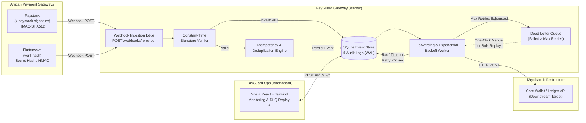
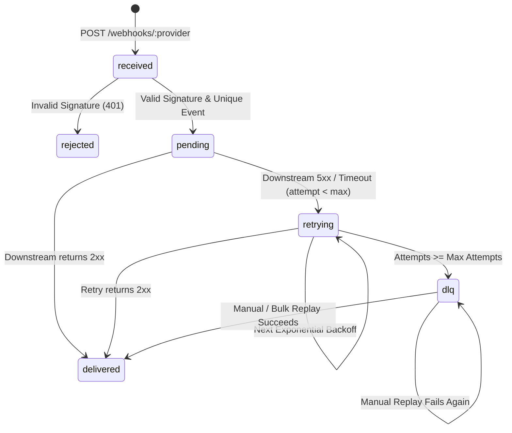

# 🛡️ PayGuard

**Open-Source Payment Webhook Gateway & Dead-Letter Queue for African Fintechs (Paystack & Flutterwave)**

[](LICENSE)
[](https://www.python.org/)
[](https://vitejs.dev/)
[](CONTRIBUTING.md)

PayGuard is a self-hosted, lightweight payment webhook ingestion gateway, cryptographic signature verifier, idempotency filter, automatic retry engine, and Dead-Letter Queue (DLQ) built specifically for African fintech teams integrating **Paystack** and **Flutterwave**.

---

## 🚨 The Problem Statement

In African fintech and digital commerce (Nigeria, Ghana, Kenya, South Africa, Egypt, and across the continent), asynchronous payment methods—such as **Bank Transfers**, **USSD**, **Mobile Money (M-Pesa / MoMo)**, and **3DS Card Flows**—rely entirely on webhooks (`charge.success`, `transfer.success`, `charge.completed`) to credit customer wallets and fulfill orders.

However, engineering teams frequently run into critical webhook reliability failures:
1. **Unannounced Downstream Downtime**: If your core banking or wallet microservice restarts, deploys, or experiences a database lock when Paystack or Flutterwave fires a webhook, the event fails.
2. **Inconsistent Provider Retry Policies**: Payment gateways stop retrying after a fixed window, or retry too aggressively during an outage. Once retries are exhausted, **customer payments remain uncredited** ("*I was debited but my wallet wasn't funded*"), leading to manual reconciliation nightmares and support tickets.
3. **Inconsistent Signature Mechanisms**: Paystack uses `HMAC-SHA512` over the raw request body in `x-paystack-signature` (and reports amounts in minor units like kobo/pesewas), whereas Flutterwave uses `verif-hash` secret comparison (and reports amounts in major units).
4. **Duplicate Webhook Deliveries**: Network blips cause gateways to send the same `charge.success` webhook multiple times, risking double-crediting if downstream handlers aren't strictly idempotent.

**PayGuard solves this** by sitting at the edge of your infrastructure: it verifies cryptographic signatures in constant time, persists raw payloads to disk in **SQLite (WAL mode)** before returning `200 OK` to the payment provider in milliseconds, deduplicates repeated events, forwards events to your core backend with **exponential backoff**, and isolates permanently failed webhooks in a **Dead-Letter Queue (DLQ)** with one-click replay from a real-time **React Dashboard**.

---

## 🏗️ Architecture Diagram



### Webhook Lifecycle State Machine



---

## ✨ Key Features

- 🔐 **Zero-Trust Signature Verification**:
  - **Paystack**: `HMAC-SHA512` over raw request bytes (`x-paystack-signature`). Automatically converts minor units (kobo/pesewas/cents) to major currency units for display while preserving the exact raw payload for forwarding.
  - **Flutterwave**: Constant-time `hmac.compare_digest` verification of `verif-hash` (plus `HMAC-SHA256` support).
- 🔁 **Idempotency & Deduplication**: Deduplicates repeated events using provider event IDs, transaction references, and SHA-256 payload fingerprints.
- 📈 **Exponential Backoff & Dead-Letter Queue (DLQ)**: Configurable retry ceiling (`MAX_RETRY_ATTEMPTS`) and exponential delay (`base_delay * 2^(attempt - 1)`). Failed webhooks automatically transition to the DLQ with full HTTP response body and error diagnostics.
- 🖥️ **Modern Operations Dashboard (`Vite + React + Tailwind + Lucide`)**:
  - Real-time KPI cards (Total Events, Delivery Success Rate, Retrying Queue, Dead-Letter Queue, Rejected Signatures, Total Volume by Currency).
  - Filterable Webhook Stream & dedicated **Dead-Letter Queue (DLQ)** view with **Single Replay** and **Bulk Replay All**.
  - Deep Payload Inspector Modal with raw JSON payload, request headers, signature status, and per-attempt HTTP delivery audit trail.
  - Built-in **Webhook Simulator** & **Downstream Target Switcher** (`Healthy 200 OK`, `Flaky 50% Fail`, `Outage 503 Down`) to test retries and DLQ behavior immediately.

---

## 🚀 Quick-Start Instructions

### Option 1: Docker Compose (Recommended)

```bash
docker-compose up --build
```
- **Backend Gateway**: `http://localhost:5000`
- **Operations Dashboard**: `http://localhost:5173`

### Option 2: Local Development (Python + Node.js)

#### 1. Start the Flask Server (`/server`)

```bash
cd server
python -m venv .venv

# Windows (PowerShell)
.\.venv\Scripts\Activate.ps1
# macOS / Linux
# source .venv/bin/activate

pip install -r requirements.txt
python app.py
```
The server starts on `http://localhost:5000` and initializes `payguard.db` automatically.

#### 2. Run the Backend Test Suite (`pytest`)

```bash
cd server
pytest -v
```

#### 3. Start the React Dashboard (`/dashboard`)

```bash
cd dashboard
npm install
npm run dev
```
Open `http://localhost:5173` in your browser.

---

## 🧪 Webhook Test `curl` Commands

By default, PayGuard uses the following development secrets (configurable via environment variables):
- `PAYSTACK_SECRET_KEY`: `sk_test_payguard_secret_key`
- `FLUTTERWAVE_SECRET_HASH`: `flw_test_payguard_secret_hash`

### 1. Send a Signed Paystack Webhook (`charge.success`)

First, compute the `HMAC-SHA512` signature of the JSON body using `sk_test_payguard_secret_key`, or run this ready-to-use `curl` command with its precomputed HMAC-SHA512 signature:

```bash
# Payload: {"event":"charge.success","data":{"id":9012831,"reference":"PSK_REF_2026_001","amount":2500000,"currency":"NGN","status":"success","customer":{"email":"adaeze@fintech.ng"}}}
# HMAC-SHA512 Signature (with secret 'sk_test_payguard_secret_key'):
# e40bf0d97dc7f8d38e6d56f6c43e21077ff4f839482e46976ca2a343b25a9f57dc1f364137dbad7e62bd09142b88f13be11aa59ec4f1f4d97c69f8bd29a8f1f4

curl -X POST http://localhost:5000/webhooks/paystack \
  -H "Content-Type: application/json" \
  -H "x-paystack-signature: $(python -c 'import hmac, hashlib; body=b"{\"event\":\"charge.success\",\"data\":{\"id\":9012831,\"reference\":\"PSK_REF_2026_001\",\"amount\":2500000,\"currency\":\"NGN\",\"status\":\"success\",\"customer\":{\"email\":\"adaeze@fintech.ng\"}}}"; print(hmac.new(b"sk_test_payguard_secret_key", body, hashlib.sha512).hexdigest())')" \
  -d '{"event":"charge.success","data":{"id":9012831,"reference":"PSK_REF_2026_001","amount":2500000,"currency":"NGN","status":"success","customer":{"email":"adaeze@fintech.ng"}}}'
```

### 2. Send a Signed Flutterwave Webhook (`charge.completed`)

Flutterwave verifies webhooks using the `verif-hash` header matching your configured `FLUTTERWAVE_SECRET_HASH`:

```bash
curl -X POST http://localhost:5000/webhooks/flutterwave \
  -H "Content-Type: application/json" \
  -H "verif-hash: flw_test_payguard_secret_hash" \
  -d '{
    "event": "charge.completed",
    "data": {
      "id": 4498120,
      "tx_ref": "FLW_TX_2026_889",
      "flw_ref": "FLW-MOCK-9928172",
      "amount": 15000,
      "currency": "KES",
      "status": "successful",
      "customer": {
        "email": "kwame@mobilemoney.ke",
        "name": "Kwame Mensah"
      }
    }
  }'
```

### 3. Test Invalid Signature Rejection (`401 Unauthorized`)

```bash
curl -i -X POST http://localhost:5000/webhooks/paystack \
  -H "Content-Type: application/json" \
  -H "x-paystack-signature: deadbeef_tampered_signature" \
  -d '{"event":"charge.success","data":{"id":999,"reference":"FAKE_TX","amount":500000,"currency":"NGN"}}'
```

### 4. Simulate Downstream Outage & Dead-Letter Queue (DLQ)

```bash
# 1. Switch downstream target to the simulated outage endpoint (503 Service Unavailable)
curl -X PUT http://localhost:5000/api/config \
  -H "Content-Type: application/json" \
  -d '{"target_webhook_url": "http://localhost:5000/api/mock-merchant/down", "max_retry_attempts": 3}'

# 2. Trigger a simulated Paystack or Flutterwave webhook
curl -X POST http://localhost:5000/api/webhooks/simulate \
  -H "Content-Type: application/json" \
  -d '{"provider": "paystack", "event_type": "charge.success", "amount": 75000, "currency": "NGN", "customer_email": "chidi@lagos.ng"}'

# 3. Restore downstream target to healthy (200 OK) and replay all DLQ events!
curl -X PUT http://localhost:5000/api/config \
  -H "Content-Type: application/json" \
  -d '{"target_webhook_url": "http://localhost:5000/api/mock-merchant/success"}'

curl -X POST http://localhost:5000/api/dlq/replay-all
```

---

## 📂 Project Structure

```text
payguard/
├── README.md                 # Documentation, architecture & curl guide
├── CONTRIBUTING.md           # Guide for adding new African payment verifiers
├── LICENSE                   # MIT License
├── docker-compose.yml        # Fullstack container orchestration
├── .gitignore                # Python & Node ignore rules
├── server/                   # Python Flask + SQLite + Pydantic + pytest
│   ├── app.py                # Flask API & webhook ingestion endpoints
│   ├── config.py             # Environment settings & runtime configuration
│   ├── database.py           # SQLite WAL persistence & DLQ queries
│   ├── models.py             # Pydantic v2 schemas & validation models
│   ├── verifiers.py          # Paystack & Flutterwave signature verifiers
│   ├── dispatcher.py         # HTTP forwarder, exponential backoff & DLQ engine
│   ├── requirements.txt      # Pinned Python dependencies
│   ├── Dockerfile            # Backend container build
│   └── tests/
│       └── test_payguard.py  # Comprehensive pytest suite
└── dashboard/                # Vite + React + Tailwind CSS + Lucide Icons
    ├── package.json
    ├── vite.config.js
    ├── tailwind.config.js
    ├── postcss.config.js
    ├── index.html
    ├── Dockerfile
    └── src/
        ├── main.jsx
        ├── App.jsx           # Full Ops Dashboard, DLQ Manager & Payload Inspector
        └── index.css         # Tailwind directives & custom scrollbars
```

---

## 🤝 Contributing

We welcome contributions adding verifiers for **Monnify**, **Korapay**, **Squad**, **M-Pesa Daraja**, **Pawapay**, **Payfast**, and **Yoco**! Please read [CONTRIBUTING.md](CONTRIBUTING.md) for instructions on implementing a new `WebhookVerifier`.

## 📄 License

Distributed under the MIT License. See [LICENSE](LICENSE) for more information.
